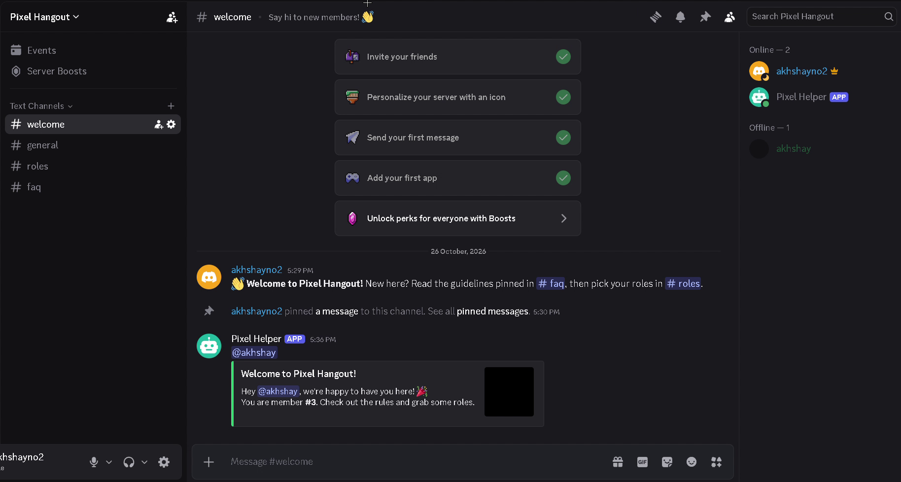
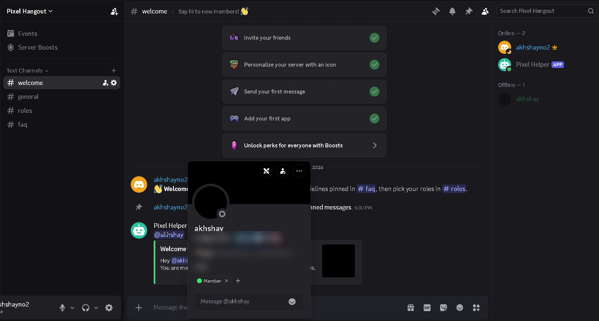
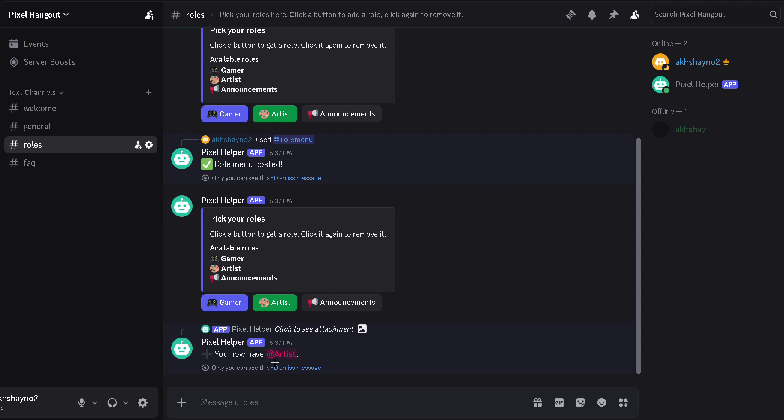
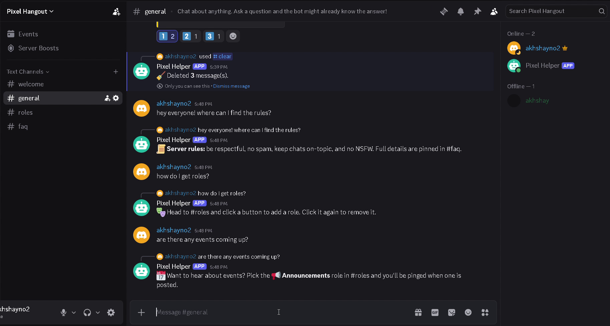
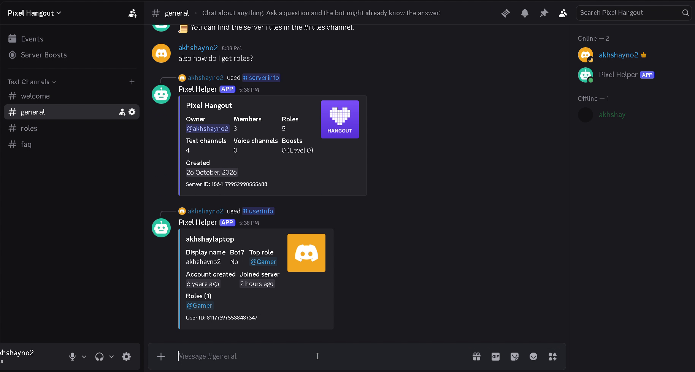
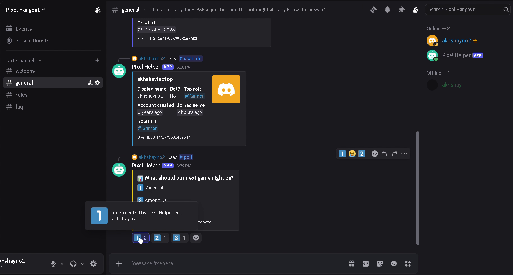
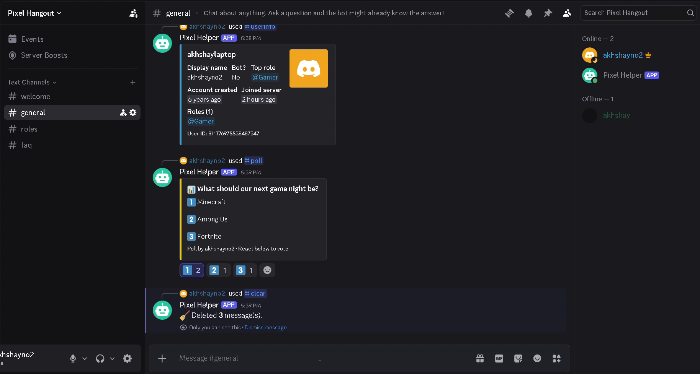

# Discord Utility Bot

An all-in-one Discord server helper built with **Python** and **discord.py 2**, using modern slash commands.
Every setting lives in `config.json`, so you can customise it without touching the code.



▶️ **[Watch the 1-minute demo video](screenshots/demo.mp4)**

## Features

| Feature | What it does |
|---|---|
| 👋 Welcome messages | Posts a friendly embed when someone joins and gives them an auto-role |
| 🎭 Role buttons | `/rolemenu` posts buttons members click to add/remove roles themselves (works after restarts) |
| ❓ FAQ auto-reply | Replies automatically when a message contains a keyword like "rules" (with anti-spam cooldown). Comes with 8 example FAQs |
| 🛠️ Utility | `/ping`, `/serverinfo`, `/userinfo`, `/poll` (2–4 options with reaction voting) |
| 🛡️ Moderation | `/clear` (bulk delete) and `/timeout` — only usable by staff with the right permissions |
| 💬 Clear errors | Tells you exactly which permission is missing or when the bot's role is too low |

## Screenshots

| Welcome message | Auto-role on join | Role buttons |
|---|---|---|
|  |  |  |

| FAQ auto-replies | /serverinfo and /userinfo | /poll |
|---|---|---|
|  |  |  |

| /clear |
|---|
|  |

## Project structure

```
discord-utility-bot/
├── bot.py              # Start here: loads token, features, and slash commands
├── config.json         # All customisable settings
├── .env.example        # Template for your secret bot token
├── requirements.txt    # Python packages needed
├── cogs/               # One file per feature
│   ├── welcome.py
│   ├── roles.py
│   ├── faq.py
│   ├── utility.py
│   └── moderation.py
└── utils/
    ├── config.py       # Reads config.json with friendly error messages
    └── checks.py       # Shared "can the bot manage this role?" check
```

## Setup (Windows)

### 1. Create the bot in Discord
1. Go to the [Discord Developer Portal](https://discord.com/developers/applications) → **New Application**.
2. Open the **Bot** tab → **Reset Token** → copy the token (keep it secret!).
3. On the same page, turn ON **Server Members Intent** and **Message Content Intent**, then save.
4. Open **OAuth2 → URL Generator**:
   - Scopes: `bot` and `applications.commands`
   - Bot permissions: `Manage Roles`, `Moderate Members`, `Manage Messages`, `Read Message History`,
     `View Channels`, `Send Messages`, `Embed Links`, `Add Reactions`
5. Open the generated URL and invite the bot to your server.

### 2. Install
Requires [Python 3.10+](https://www.python.org/downloads/). In a terminal inside this folder:

```powershell
python -m venv .venv
.\.venv\Scripts\activate
pip install -r requirements.txt
```

### 3. Add your token
Copy `.env.example` to a new file called `.env` and paste your token:

```
DISCORD_TOKEN=your-token-here
```

`.env` is listed in `.gitignore`, so it is never uploaded to GitHub.

### 4. Configure `config.json`
Turn on **Developer Mode** in Discord (User Settings → Advanced) so you can right-click → **Copy ID**.

| Setting | Meaning |
|---|---|
| `guild_id` | Your server ID. Commands appear **instantly** in that server. Use `0` for global (slower to appear). |
| `welcome.channel_id` | Channel where welcome messages are posted |
| `welcome.auto_role` | Role name given to every new member (`""` to disable) |
| `welcome.title` / `message` | Text with placeholders: `{mention}`, `{name}`, `{server}`, `{member_count}` |
| `role_menu.roles` | Buttons: `name` (must match a role exactly), `emoji`, `style` (`blurple`, `green`, `red`, `grey`) |
| `faq.entries` | Each entry has a list of `keywords` and the `answer` to reply with |
| `faq.cooldown_seconds` | How long before the same FAQ can be answered again in a channel |
| `moderation.max_clear` | Maximum messages `/clear` can delete at once |

Create the roles (e.g. `Member`, `Gamer`, `Artist`, `Announcements`) in your server first.

### 5. Important: role order
In **Server Settings → Roles**, drag the bot's role **above** every role it should give out and above
members it should be able to time out. Discord does not let bots manage roles higher than their own.

### 6. Run
```powershell
.\.venv\Scripts\activate
python bot.py
```
You should see `Logged in as ...` in the terminal. Restart the bot after editing `config.json`.

## Commands

| Command | Who can use it | Description |
|---|---|---|
| `/ping` | Everyone | Shows bot latency |
| `/serverinfo` | Everyone | Server stats |
| `/userinfo [member]` | Everyone | Member details |
| `/poll question option1 option2 [option3] [option4]` | Everyone | Reaction poll |
| `/rolemenu` | Manage Roles | Posts the role buttons in the current channel |
| `/clear amount` | Manage Messages | Deletes the last N messages |
| `/timeout member minutes [reason]` | Moderate Members | Times out a member (`0` minutes removes it) |

## Troubleshooting

| Problem | Fix |
|---|---|
| `Privileged intents are not enabled` | Enable both intents in Developer Portal → Bot |
| `Discord rejected the token` | Reset the token and paste the new one into `.env` |
| Slash commands don't show up | Set `guild_id` in `config.json`, restart, and reload Discord (Ctrl+R) |
| "My role is not high enough" | Drag the bot's role higher in Server Settings → Roles |
| No welcome message | Check `welcome.channel_id` and the warnings printed in the terminal |
| `config.json has a formatting error` | Look for a missing/extra comma at the line shown |
